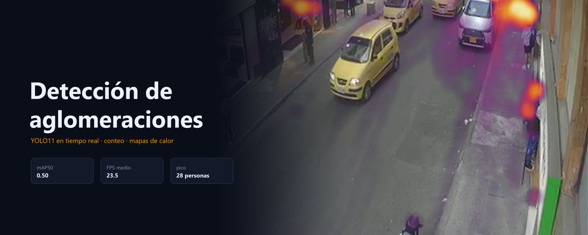
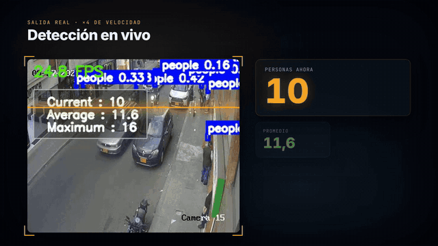
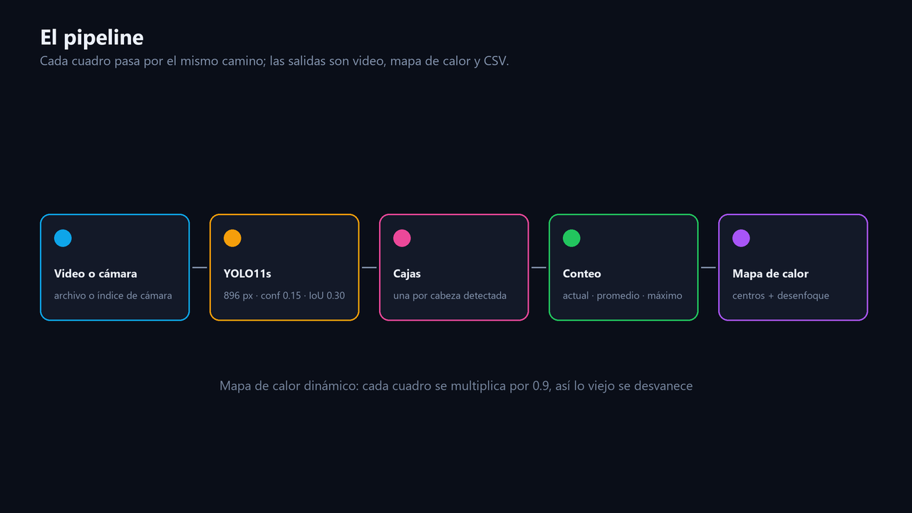
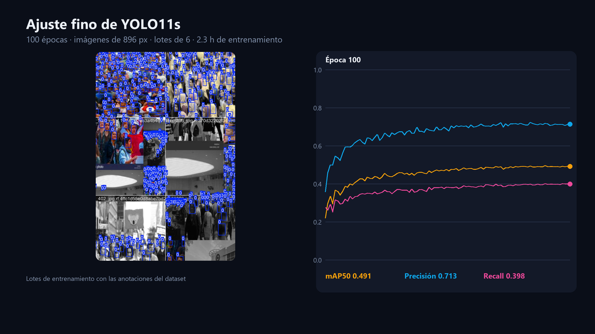
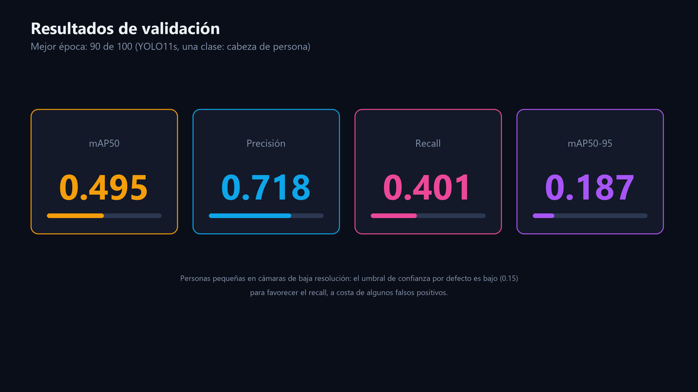
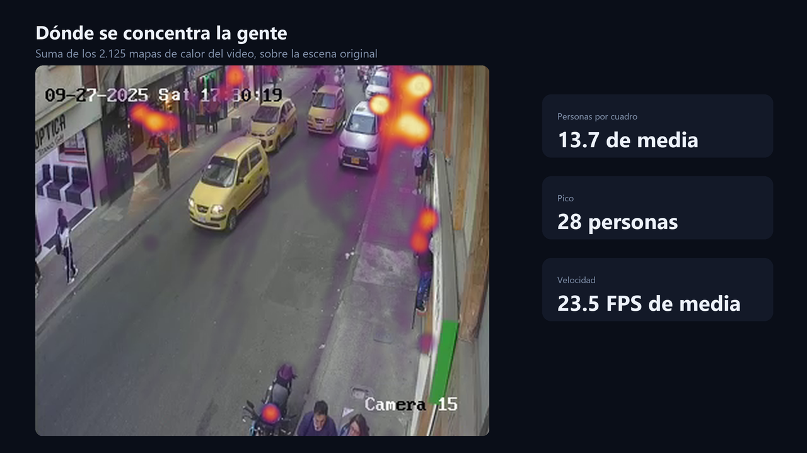

# Detección de aglomeraciones con YOLO11

<p align="center"></p>

<p align="center">
  
  
  
  
  
</p>

<p align="center"></p>

<p align="center"><a href="docs/crowd_detection.mp4"><b>▶ Ver el video completo (70 s)</b></a></p>

Sistema de visión por computador que trabaja sobre **cámaras de vigilancia que ya existen**: cuenta cuántas personas
hay en cada cuadro, lleva el promedio y el pico, y dibuja un **mapa de calor** de las zonas donde la gente se
concentra. Funciona con un video o con una cámara en vivo, desde la línea de comandos o desde una interfaz web.

| | |
|---|---|
| **Modelo** | YOLO11s ajustado durante 100 épocas para detectar cabezas en multitudes |
| **Entrada** | Archivo de video o índice de cámara (cámaras de 352 × 288 px en las pruebas) |
| **Salidas** | Video con detecciones y contador, video del mapa de calor, PNG acumulado y CSV por cuadro |
| **Velocidad** | 23,5 FPS de media sobre 2.125 cuadros |
| **Interfaz** | CLI configurable por YAML + interfaz Gradio con pestañas para subir video o grabar con la cámara |

Las animaciones e imágenes de este README se generan a partir de **las salidas reales que están en el repositorio**
(`output/` y `results/`), sin volver a dibujar nada a mano: ver [`docs/animacion/generar.py`](docs/animacion/generar.py).

---

## Cómo funciona

<p align="center"></p>

1. **Lectura** (`src/video_io.py`): toma cuadros de un archivo o de una cámara.
2. **Detección** (`src/detector.py`): YOLO11s a 896 px, confianza 0,15 e IoU 0,30, filtrando la clase `head`.
   Las personas en una cámara de calle ocupan pocos píxeles; por eso se infiere a una resolución mayor que la del
   video y con un umbral de confianza bajo, que favorece el recall.
3. **Conteo** (`src/metrics.py`): número de detecciones del cuadro, promedio acumulado y máximo.
4. **Mapa de calor** (`src/utils/heatmap.py`): cada centro de caja suma en un acumulador; se suaviza con un
   desenfoque gaussiano (kernel 31) y se colorea. En la versión dinámica el acumulador se multiplica por 0,9 en
   cada cuadro, así que lo antiguo se desvanece y el mapa sigue el movimiento.
5. **Superposición** (`src/overlay.py`): dibuja las cajas, el contador *Current / Average / Maximum* y los FPS.
6. **Salidas** (`src/utils/processor.py`): video anotado, video del mapa de calor, PNG y CSV con una fila por cuadro.

---

## Entrenamiento

<p align="center"></p>

Se partió de `yolo11s.pt` y se ajustó con un dataset de cabezas en multitudes: 100 épocas, imágenes de 896 px,
lotes de 6, unas 2,3 h de entrenamiento. Las curvas, matrices de confusión y lotes de ejemplo están en `results/`.

<p align="center"></p>

| Métrica (validación) | Mejor época (90) | Última época (100) |
|---|---|---|
| mAP50 | **0,495** | 0,491 |
| Precisión | 0,718 | 0,713 |
| Recall | 0,401 | 0,398 |
| mAP50-95 | 0,187 | 0,184 |

Las cabezas pequeñas y parcialmente tapadas son el caso difícil: la precisión es buena, pero el recall se queda
cerca de 0,40 en validación. En operación eso se compensa bajando el umbral de confianza a 0,15.

---

## Resultados sobre video real

<p align="center"></p>

Sobre 2 min 19 s de una cámara de calle (2.125 cuadros), el sistema contó **13,7 personas por cuadro de media**,
con un **pico de 28**, a 23,5 FPS. El mapa acumulado deja ver dónde se concentra la gente: sobre todo en las aceras,
casi nada en la calzada.

En una segunda cámara, procesada desde la interfaz web, el conteo llegó a **41 personas en un mismo cuadro**.

| Escena | Cuadros | Promedio | Pico |
|---|---|---|---|
| Cámara de calle (`output/salida_detectada.mp4`) | 2.125 | 13,7 | 28 |
| Escena densa, interfaz Gradio (`output/gradio/1763611667/`) | 1.836 | 20,3 | 41 |

---

## Cómo ejecutarlo

```bash
python -m venv .venv
.venv\Scripts\activate          # en Linux/macOS: source .venv/bin/activate
pip install -r requirements.txt
```

**Línea de comandos.** Toda la configuración está en [`config/config.yml`](config/config.yml) (modelo, fuente,
umbrales, mapa de calor y CSV):

```bash
python main.py                              # usa config/config.yml
python main.py --config otra_config.yml     # o un archivo propio
```

Para usar una cámara, pon `source: 0`; para generar el mapa de calor, `heatmap: true`. Con la ventana de OpenCV
abierta, `Esc` o `q` cierra la aplicación.

**Interfaz web.**

```bash
python gradio_ui.py
```

Tiene dos pestañas, **Upload** (subir un video) y **Camera** (grabar un clip), y deja elegir qué salidas generar
(video con detecciones, video del mapa de calor, PNG, CSV) y ajustar el kernel y el decaimiento del mapa.

**Reentrenar el modelo.**

```bash
yolo task=detect mode=train model=yolo11s.pt data=dataset.yaml epochs=100 imgsz=896 batch=6
```

**Regenerar el video y las imágenes de este README.**

```bash
pip install numpy pillow imageio-ffmpeg
python docs/animacion/generar.py
```

## Estructura

```
main.py                  ejecución por línea de comandos
gradio_ui.py             interfaz web (subir video o grabar con la cámara)
config/config.yml        configuración por defecto
src/
  cli.py                 carga de configuración (YAML + --config)
  detector.py            envoltorio de YOLO11s
  video_io.py            lectura y escritura de video
  overlay.py             cajas, contador y FPS sobre el cuadro
  metrics.py             conteo actual, promedio y máximo
  utils/heatmap.py       acumulador, desenfoque gaussiano y coloreado
  utils/processor.py     bucle principal y salidas (video, mapa de calor, CSV)
models/best.pt           pesos ajustados
results/                 curvas y métricas del entrenamiento
output/                  salidas de ejemplo
docs/                    video, GIF e imágenes del README (generados por docs/animacion/generar.py)
```
